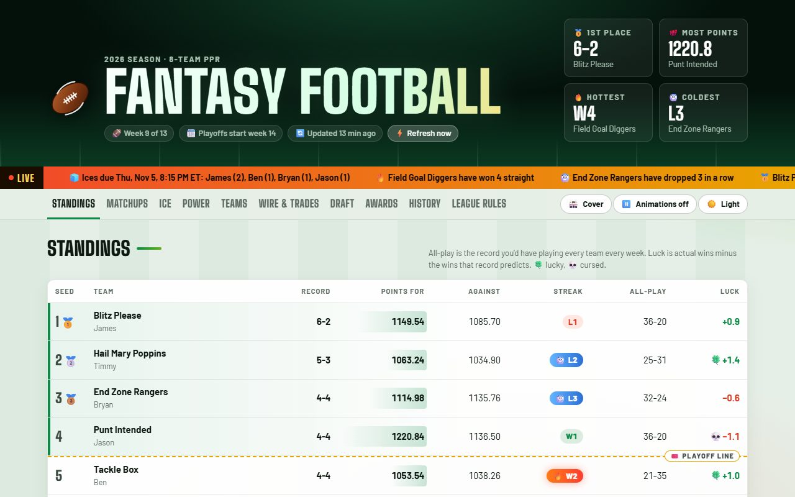

# Fantasy Football

A public stats site for an 8-team, full-PPR ESPN fantasy football league: standings, live scores,
matchups, power rankings, awards, draft and trade history, head-to-head records and an ice penalty
tracker.

**Live site:** https://offthewall.dev/fantasy-football/

## Who it's for

The league's members, who check it on game days, and anyone curious how a league site like this is
built. This public copy uses football-pun team names and first names only; the league keeps its own
unlisted copy with real names.

## How it's built

This repo holds **published output only**. Nothing here is edited by hand. The site is built from the
source repo **[billywall732/fantasy-feetpics](https://github.com/billywall732/fantasy-feetpics)**, where a
GitHub Actions workflow pulls the latest data from the ESPN Fantasy API, builds this copy, checks that no
private names reach the page, and pushes it to this repo's `gh-pages` branch, which GitHub Pages serves.
It refreshes daily, hourly on Sundays, and on demand from the site's Refresh now button.

To change the site, see the source repo's README.

## License

[MIT](LICENSE)
